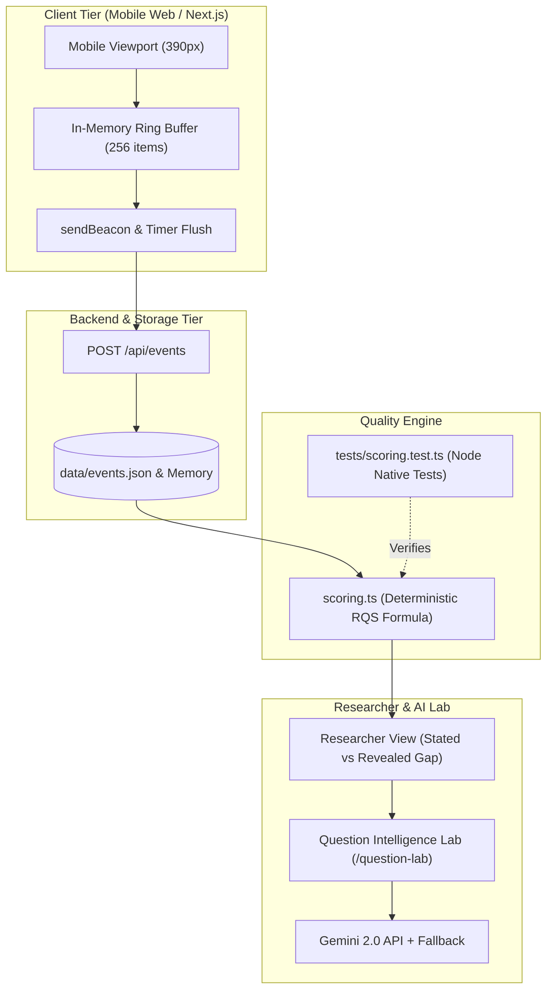

# Challenge 1 Part B: Behavioral Tracking & Response Quality Engine

> **Status:** Production Architecture & Strategy Document  
> **Core Goal:** Explain how we capture real human behavior on mobile, score response quality, detect bots, and continuously improve survey questions in simple, practical developer terms.

---

##  Executive Summary 

Most consumer survey apps fail for two reasons:
1. **They only record the final answer:** They don't know if the user read the question for 15 seconds or randomly tapped Option A in 300 milliseconds.
2. **They treat all fast users as bots:** They use crude timers and end up banning smart, fast-reading humans while letting sophisticated bot scripts pass.

This app solves this with a **lightweight, high-frequency telemetry engine**:
- We record **how** the user plays (time spent thinking, mouse/touch hovers, changed choices, touch wobble).
- We compute an explainable, deterministic **Response Quality Score (RQS)** from 0 to 100 with explicit reason codes (`SPEEDING`, `STRAIGHT_LINING`, `ATTENTION_FAILED`).
- We distinguish fast humans from bots using physical touch signals (humans have hand tremors and oval touch contact areas; bots click exact pixel coordinates).
- We use AI where it shines (analyzing questions for bias in the Question Lab) and keep it away from where it fails (we NEVER put a slow, expensive LLM in the real-time click loop).

---

## 1. Event Tracking Architecture (How Frontend Telemetry Works)

```
┌────────────────────────────────────────────────────────────────────────┐
│                        HOW TELEMETRY FLOWS                             │
│                                                                        │
│  [User taps, hovers, changes mind]                                     │
│                │                                                       │
│                ▼                                                       │
│  [In-Memory Ring Buffer (256 items)] ──▶ Avoids running out of RAM     │
│                │                                                       │
│        ┌───────┴───────┐                                               │
│        ▼               ▼                                               │
│  Every 3 Seconds    When Tab Closes                                    │
│  (Batched POST)     (navigator.sendBeacon)                             │
│        │               │                                               │
│        └───────┬───────┘                                               │
│                ▼                                                       │
│       POST /api/events (Next.js API Route)                             │
│                │                                                       │
│                ▼                                                       │
│       In-Memory Array + append to data/events.json                     │
│       (In production: Kafka / Kinesis Stream ──▶ TimescaleDB)          │
└────────────────────────────────────────────────────────────────────────┘
```

### 1.1 Why an "In-Memory Ring Buffer"?
- **The Problem:** If you track mouse moves and touch events on a budget Android phone, you can generate 50 events per second. If you keep appending them to a standard JavaScript array `events.push(e)`, the phone will run out of memory and the UI will lag ("jank").
- **The Solution:** A fixed-size **Ring Buffer** of 256 items. When it hits index 255, it wraps back to 0. It takes a constant ~50 KB of RAM, guaranteed.

### 1.2 Why `navigator.sendBeacon`?
- **The Problem:** When a user closes the tab or switches apps on mobile, normal `fetch('/api/events')` gets cancelled by the browser immediately. You lose all the data from their final screen.
- **The Solution:** `navigator.sendBeacon()`. This is a native browser API designed specifically for analytics. The browser guarantees that the HTTP request will finish in the background even after the tab is completely closed.

### 1.3 The 4 Groups of Events We Track

```typescript
// 1. Session & Screen Lifecycle
"session_start"      // App loaded, viewport size, device OS recorded
"screen_view"        // User navigated to a new slot (e.g. 'slot_outerwear')
"window_blur"        // User switched tabs (did they switch to ChatGPT or a cheat sheet?)
"session_complete"   // Reached results screen
"session_abandon"    // Left without finishing

// 2. In-Game Deliberation (Micro-Interactions)
"card_hover"         // Hovered mouse or touched card without selecting yet
"card_selected"      // Tapped to select an item
"selection_changed"  // Changed their mind! Swapped item A for item B (shows trade-off thinking)
"detail_sheet_open"  // Tapped to read fabric/materials details (shows high interest)

// 3. Disruptions & Quality Traps
"disruption_shown"   // Flash sale or budget cut popped up
"disruption_response"// How they reacted after the 1.5s delay
"probe_answered"     // Answered an attention check or repeated consistency question

// 4. Rewards
"reward_unlocked"    // ₹50 reward credited to user escrow
```

---

## 2. Key Metrics & KPIs (What Researchers Look At)

| Metric | What It Actually Means | Target Benchmark | What Red Flags Look Like |
| :--- | :--- | :--- | :--- |
| **Completion Rate** | % of people who start the game and reach the end screen. | $\ge 82\%$ | If it drops below $70\%$, the game is too long or a screen is broken. |
| **Median Decision Time** | How long a user spends looking at the 4 cards before picking one. | $6.5\text{s} - 9.0\text{s}$ per slot | $< 2.0\text{s}$ means speedrunning/botting.<br>$> 30\text{s}$ means confusing card descriptions. |
| **First-Action Dwell** | Time between screen load and the user's very first tap/hover. | $1.2\text{s} - 2.8\text{s}$ | $< 0.3\text{s}$ means they tapped without even looking at the screen. |
| **Reversal Rate** | % of slots where the user picked an item, then changed their mind to another. | $20\% - 45\%$ | $0\%$ reversals across all 5 slots often indicates unthinking, robotic clicking. |
| **High-Quality Sample Share** | % of sessions with a Response Quality Score $\ge 75$. | $\ge 78\%$ of sample | If this is low, your survey incentives are attracting click-farmers. |

---

## 3. Response Quality Scoring Engine (RQS Explained Simply)

Instead of using an unexplainable machine learning model ("the AI says this user is bad, but we don't know why"), we use a **100-point transparent credit score**:

```
┌────────────────────────────────────────────────────────────────────────┐
│                   RESPONSE QUALITY SCORE (0 TO 100)                    │
│                                                                        │
│   0                    50                   75                   100   │
│   ├─── LOW (DISCARD) ──┼── REVIEW (AUDIT) ──┼── HIGH (ACCEPTED) ─┤   │
│   │                    │                    │                    │   │
│   Bots, speedrunners,  Fast responders,     Thoughtful humans,   │   │
│   straight-liners      minor inconsistency  read cards, passed   │   │
│   (Payout rejected)    (Manual check)       all checks (Paid!)   │   │
└────────────────────────────────────────────────────────────────────────┘
```

### 3.1 The 6 Weighted Components (Sum = 100 Points)

1. **Attention Check (25% Weight):**
   - We include one disguised card: *"Attention Check: Select this basic tee to confirm you are reading."*
   - If they select it: **+25 points**. If they miss it: **0 points**.
2. **Consistency Probe (20% Weight):**
   - On Slot 5, we present a repeated scenario with swapped card positions.
   - If their preference matches their earlier choice: **+20 points**.
3. **Speeding Gradient (20% Weight):**
   - If average time per decision $< 2.2$ seconds: heavy penalty (reading 4 cards in 1 second is physically impossible for a human).
   - If between $2.2\text{s}$ and $7.0\text{s}$: scaled score.
   - If $\ge 7.0$ seconds: full **+20 points**.
4. **Position Bias / Straight-Lining (15% Weight):**
   - If a user clicks the 1st card on 4 or 5 slots in a row: **0 points**. They are just tapping the top of their screen.
5. **Social Desirability Check (10% Weight):**
   - Did they pick 100% sustainable items in under 2 seconds without checking price? Flagged for fake virtue-signaling.
6. **Interaction Depth (10% Weight):**
   - Did they open details sheets, hover, or compare items? Points awarded for active exploration.

### 3.2 Deductions & Penalties
- **Tab Switching (`$P_{\text{blur}}$`):** Deduct 4 points every time they switch tabs (up to -16 points). Bots often run in background tabs.
- **Reverse-Framed Trap (`$P_{\text{reverse}}$`):** Deduct 15 points if they pick the blatantly toxic, expensive trap card.

### 3.3 Diagnostic Reason Codes
When a user finishes, their score comes with clear programmatic strings:
- `SPEEDING`: Tapped through without reading.
- `POSITION_BIAS`: Tapped Card #1 every time.
- `ATTENTION_FAILED`: Clicked the wrong card on the trap question.
- `INCONSISTENT`: Contradicted themselves on the repeated test.

---

## 4. How to Tell a Fast Human from a Bot

A big problem in consumer research is **banning smart, fast readers** by mistake. Here is how we differentiate a fast human from a script:

```
┌────────────────────────────────────────────────────────────────────────┐
│             FAST HUMAN vs. AUTOMATED BOT (THE DIFFERENCE)              │
├──────────────────────────────────┬─────────────────────────────────────┤
│ Metric                           │ Mindless Bot / Script │ Fast Human  │
├──────────────────────────────────┼──────────────────────┼──────────────┤
│ 1. Touch Wobble (Micro-Jitter)   │ 0px tremor (exact)   │ Natural hand │
│                                  │ (x: 150.00, y: 300.0)│ tremor/wobble│
├──────────────────────────────────┼──────────────────────┼──────────────┤
│ 2. Touch Area / Radius           │ 0 radius (point)     │ Oval shape   │
│                                  │                      │ (finger pad) │
├──────────────────────────────────┼──────────────────────┼──────────────┤
│ 3. Reading vs Slot Complexity    │ Flat 800ms on every  │ Fast on Tees,│
│                                  │ slot uniformly       │ slower on    │
│                                  │                      │ Outerwear    │
├──────────────────────────────────┼──────────────────────┼──────────────┤
│ 4. Trap Questions                │ Fails attention      │ Passes 100%  │
│                                  │ check 100% of time   │ of checks    │
└──────────────────────────────────┴──────────────────────┴──────────────┘
```

1. **Physical Finger Dynamics:** On real smartphones, `TouchEvent.radiusX` and `radiusY` represent the physical oval of a human finger touching glass. Puppeteer / Selenium bots send synthetic clicks with zero radius.
2. **Variable Timing:** A fast human takes 2 seconds on a simple T-Shirt, but 5 seconds on a complicated Outerwear jacket with a budget cut. A bot clicks every screen at exactly `800ms ± 20ms`.
3. **Trap Accuracy:** A fast human still reads the text and passes the attention check. A bot that blindly clicks the top card fails every single time.

---

## 5. Where AI Helps (And Where It Fails)

### ✅ Where AI Is Great:
1. **Question Intelligence Lab (`/question-lab`):** Using Google Gemini to inspect traditional survey questions, flag hidden biases (social desirability, double-barrelled questions), and automatically rewrite them into interactive game concepts.
2. **Offline Fraud Pattern Detection:** Running clustering algorithms (like Isolation Forests) overnight across 10,000 sessions to discover new bot farms.
3. **Detecting ChatGPT Copy-Paste:** Catching AI-generated text in open-ended text fields.

### ❌ Where AI Must NEVER Be Used:
1. **Never in the Real-Time Click Loop:** Running an LLM while a user is tapping cards adds 1–2 seconds of latency and costs money per API call. The user experience would feel sluggish and broken.
2. **Never as an Unexplainable Ban Hammer:** If an AI model bans a user, it cannot explain why. Using deterministic formulas means researchers can see: *"Score was 42 because user failed Attention Check and had 80% Position Bias."*

---

## 6. The Continuous Survey Improvement Loop

What happens when a question in production isn't working well?

```
[1. Ingest Telemetry] ──▶ [2. Compute RQS Quality]
          ▲                           │
          │                           ▼
[5. AI Rewrites Question] ◀── [3. Check Question Health]
                              - High drop-off rate (>8%)?
                              - Nobody picked the decoy?
                              - Everyone straight-lined?
```

1. **Auto-Quarantine:** If a question has an abnormally high drop-off rate ($>8\%$) or everyone straight-lines through it, the system automatically flags it.
2. **AI Rewrite:** The question is sent to the Question Intelligence Lab. Gemini suggests an updated mechanic (e.g., changing from a 4-card grid to a head-to-head duel).
3. **A/B Testing:** 10% of users see the new version until data quality improves.

---

## 7. System Architecture (How the Pieces Connect)



---
