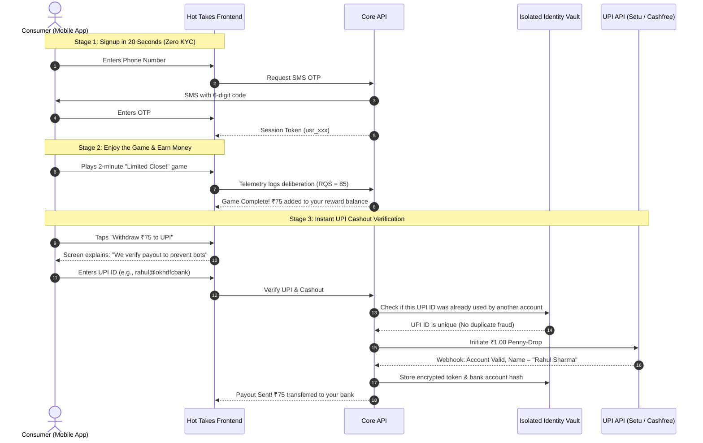

# Challenge 2: Trustworthy Consumer Onboarding & Verification System

> **Status:** Production Architecture & Strategy Document  
> **Topic:** Designing a Frictionless, Fraud-Resistant Onboarding & Verification Flow for the Indian Market  
> **Core Concept:** "Play-to-Earn, Verify-to-Redeem" (Progressive Trust)

---

##  Executive Summary 

If an Indian mobile app asks a new user for their **Aadhaar card or bank account number on Screen 1**, more than **70% of people immediately delete the app**. 

Users don't trust a new app with their government identity for the vague promise of earning ₹50. Furthermore, calling government verification APIs upfront for every download burns massive cash on bots and casual drop-offs.

We can flip this completely using a pattern called **"Play-to-Earn, Verify-to-Redeem"**:
1. **Zero-Friction Signup:** Users enter just a phone number and OTP. They are in the app and playing their first wardrobe game in **under 30 seconds**.
2. **Earn Rewards First:** Users curate their capsule wardrobe, have fun, and accumulate **real monetary reward credit (e.g. ₹75)** into an in-app escrow balance.
3. **Verify Only When Cashing Out:** When the user taps *"Withdraw ₹75 to Bank"*, they now have a strong motivation to verify themselves.
4. **Lightweight Verification via UPI Penny-Drop:** Instead of asking for Aadhaar photos, we send **₹1 via UPI**. NPCI (India's payment network) instantly tells us the official bank account holder's legal name. It takes 4 seconds, costs ₹1.20, and requires zero paperwork.
5. **DPDP Act Privacy Compliance:** We keep all personal identities (names, bank accounts) in a **physically isolated Identity Vault**, completely separate from the survey responses database.

---

## 1. Comparing Verification Rails in India (Which One Should We Use?)

There are several ways to verify someone's identity in India. Here is how they compare in practical engineering and cost terms:

| Verification Method | How It Works in Code | Cost per Check | User Friction | Verdict for Hot Takes |
| :--- | :--- | :--- | :--- | :--- |
| **Phone Number OTP** | SMS gateway sends a 6-digit code. | ₹0.15 | **Very Low** (Auto-read in 10s) | ✅ **Use for Entry:** Good enough for initial signup and rate-limiting. |
| **UPI Penny-Drop (Account Inquiry)** | We send ₹1 to user's UPI ID. NPCI API returns the registered legal bank account name. | ₹1.20 | **Extremely Low** (User just types `mobile@upi`) | 🏆 **Primary Choice for Cashouts (≤ ₹100):** Proves they own a real, KYC'd Indian bank account. |
| **DigiLocker OAuth** | Redirect to `digilocker.gov.in`, user enters PIN, government returns verified age/document. | ₹2.00 | **Medium** (Redirects out of app) | ✅ **Use for Big Cashouts (> ₹500):** Proves they are 18+ years old. |
| **Aadhaar OTP (KUA/AUA)** | UIDAI sends an SMS to the phone number registered on their Aadhaar card. | ₹4.50 – ₹6.00 | **High** (Needs KUA license, causes severe user privacy panic) | ❌ **Rejected for Daily Use:** Too expensive, too invasive, high drop-off. |
| **Upload Photo ID / Selfie** | User uploads a selfie and a photo of their ID card. | ₹4.00 | **Extremely High** (Needs good camera, lighting, manual review) | ❌ **Rejected:** Kills conversion; only use for manual fraud appeals. |

### Why UPI Penny-Drop is the Clear Winner:
1. **It's virtually zero friction:** The user already knows their UPI ID (GPay, PhonePe, Paytm). They don't need to find their physical Aadhaar card.
2. **It guarantees they are a real human adult:** You cannot get a UPI ID in India without having an active bank account that already went through bank KYC.
3. **It's instant:** Takes 4 seconds via API, compared to manual document review which takes hours.
4. **It costs only ₹1.20:** Aadhaar KUA authentication costs ₹4–₹6 per attempt.

---

## 2. The User Journey: "Play-to-Earn, Verify-to-Redeem"



### The 2 Screens (ASCII Wireframes)

```
┌─────────────────────────────────┐      ┌─────────────────────────────────┐
│ HOT TAKES              [Skip]   │      │ CASH OUT REWARD         [Exit]  │
├─────────────────────────────────┤      ├─────────────────────────────────┤
│                                 │      │                                 │
│  Build your wardrobe            │      │  ₹75.00 Earned                  │
│  on a budget.                   │      │  Ready for Instant Transfer     │
│                                 │      │                                 │
│  Curate 5 pieces with ₹3,000.   │      │  ──────── How Payouts Work ──── │
│  Takes about 2 minutes.         │      │  • 1 Payout per real human      │
│                                 │      │  • Instant transfer to your UPI │
│  Mobile Number                  │      │  • Encrypted & private          │
│  [ +91 98765 43210            ] │      │                                 │
│                                 │      │  Enter UPI ID (GPay / PhonePe)  │
│  [✓] I agree to anonymous       │      │  [ rahul@okhdfcbank           ] │
│      research telemetry.        │      │                                 │
│                                 │      │  [  Verify & Transfer ₹75  ]    │
│  [     Start Playing (OTP)    ] │      │                                 │
│                                 │      │  🔒 Bank-grade 256-bit security │
│  Anonymous. No KYC to play.     │      │     Zero passwords requested    │
└─────────────────────────────────┘      └─────────────────────────────────┘
  (Screen 1: Instant Entry)                (Screen 2: Cashout Verification)
```

---

## 3. System Architecture & The "Identity Vault" Pattern

Under India’s **Digital Personal Data Protection (DPDP) Act 2023**, you cannot mix personal identity data with survey research answers. If your database ever gets leaked or audited, researchers must NEVER be able to see a user's real bank account or legal name.

We solve this using **Physical & Cryptographic Vault Isolation**:

```
┌────────────────────────────────────────────────────────────────────────┐
│                        TWO SEPARATE DATABASES                          │
│                                                                        │
│   DATABASE 1: PUBLIC RESEARCH DB          DATABASE 2: IDENTITY VAULT   │
│   (What Researchers & Brands See)         (Locked Down, Restricted VPC)│
│   ┌─────────────────────────────┐         ┌───────────────────────────┐│
│   │ id: 'usr_abc123'            │         │ user_id: 'usr_abc123'     ││
│   │ top_choice: 'Oversized Tee' │         │ real_name: AES_ENCRYPTED  ││
│   │ sustainability_score: 80%   │         │ upi_hash: SHA256(vpa)     ││
│   │ rqs_quality: 92             │         │ verified_at: timestamp    ││
│   └─────────────────────────────┘         └───────────────────────────┘│
│                  ▲                                       ▲             │
│                  │                                       │             │
│                  └───────────────────┬───────────────────┘             │
│                                      │                                 │
│                        NO FOREIGN KEYS ACROSS DATABASES                │
│                        Decoupled by design for privacy                 │
└────────────────────────────────────────────────────────────────────────┘
```

### Why This Architecture Matters:
1. **Zero Liability on Data Breach:** If the research database is hacked, the hacker only gets anonymous survey responses (`usr_abc123 bought a jacket`). There are no names, no phone numbers, and no bank accounts.
2. **Right to Erasure (DPDP Act):** If a user says *"Delete my account"*, we delete their record in the Identity Vault. Their anonymized research statistics remain in the research warehouse without violating the law.

---

## 4. Multi-Vector Fraud Detection (Catching Click Farms & Bots)

A "click farm" is one scammer sitting in a room with 30 cheap Android phones, trying to play the game 30 times to pocket ₹50 rewards repeatedly. 

We catch them using **Multi-Vector Deduplication**:

```
┌────────────────────────────────────────────────────────────────────────┐
│                   HOW WE DETECT MULTI-ACCOUNT FRAUD                    │
│                                                                        │
│   [Bank Account Hash] ────────┬──────── [Phone Number Hash]            │
│                               │                                        │
│                               ▼                                        │
│                    [Entity Deduplication Check]                        │
│                               ▲                                        │
│                               │                                        │
│   [Device Hardware Fingerprint]─────── [IP Subnet / Wi-Fi Network]     │
└────────────────────────────────────────────────────────────────────────┘
```

1. **Bank Account Collision:** Even if the scammer has 30 phone SIM cards, they usually try to withdraw money to the **same bank account or UPI ID**. As soon as our Identity Vault detects `SHA256(upi_id)` already exists on another account, the payout is blocked.
2. **Device Hardware Fingerprinting:** On mobile devices, we check hardware concurrency, GPU canvas renderer, and screen resolution. If 5 accounts are registered from the exact same physical phone, they are flagged.
3. **Android Play Integrity API:** Detects if the app is running on a rooted device, virtual emulator (like BlueStacks), or spoofed GPS.

---

## 5. PostgreSQL Database Schema (Clean & Practical DDL)

Here are the database tables written in standard PostgreSQL:

```sql
-- 1. Main Users Table (Stores anonymous research profiles)
CREATE TABLE users (
    id UUID PRIMARY KEY DEFAULT gen_random_uuid(),
    pseudonymous_id VARCHAR(64) UNIQUE NOT NULL, -- Exposed to analytics (e.g. 'usr_98124')
    phone_hash VARCHAR(64) NOT NULL,             -- HMAC-SHA256 of phone (never store raw number!)
    verification_status VARCHAR(32) DEFAULT 'NOT_STARTED', -- NOT_STARTED, PENDING, VERIFIED, FAILED
    trust_score INT DEFAULT 50,                  -- Score from 0 to 100
    created_at TIMESTAMPTZ DEFAULT NOW()
);

-- 2. Payout Verification Attempts (Audit log of every UPI attempt)
CREATE TABLE verification_attempts (
    id UUID PRIMARY KEY DEFAULT gen_random_uuid(),
    user_id UUID REFERENCES users(id) ON DELETE CASCADE,
    provider_name VARCHAR(32) NOT NULL,          -- 'SETU', 'CASHFREE', 'DIGILOCKER'
    verification_type VARCHAR(32) NOT NULL,      -- 'UPI_PENNY_DROP'
    status VARCHAR(32) NOT NULL,                 -- 'SUCCESS', 'FAILED', 'RETRY_ALLOWED'
    failure_reason VARCHAR(64),                  -- 'NAME_MISMATCH', 'DUPLICATE_ACCOUNT'
    latency_ms INT,
    created_at TIMESTAMPTZ DEFAULT NOW()
);

-- 3. Isolated Identity Vault Table (Located in a separate, secure database)
CREATE TABLE identity_tokens (
    id UUID PRIMARY KEY DEFAULT gen_random_uuid(),
    user_id UUID UNIQUE NOT NULL,                -- Matches user_id from Database 1
    encrypted_legal_name BYTEA NOT NULL,         -- Encrypted with AES-256 via AWS KMS
    identifier_hash VARCHAR(64) UNIQUE NOT NULL, -- SHA256(upi_id) to detect duplicate accounts
    token_type VARCHAR(32) NOT NULL,             -- 'UPI_VPA'
    verified_at TIMESTAMPTZ DEFAULT NOW()
);

-- 4. Device Fingerprints Table (Catches multiple accounts on 1 phone)
CREATE TABLE devices (
    id UUID PRIMARY KEY DEFAULT gen_random_uuid(),
    user_id UUID REFERENCES users(id) ON DELETE CASCADE,
    device_fingerprint VARCHAR(64) NOT NULL,
    is_emulator BOOLEAN DEFAULT FALSE,
    ip_subnet VARCHAR(32),
    created_at TIMESTAMPTZ DEFAULT NOW()
);
```

---

## 6. How We Handle Real-World Edge Cases

| Edge Case | What Happens | How We Fix It |
| :--- | :--- | :--- |
| **Spelling Differences (Indic Names)** | User types *"Rahul Choudhary"*, but bank returns *"Rahul Chowdhury"*. | We don't fail them! We use a fuzzy string matching algorithm (Levenshtein distance). If it's an $80\%$ phonetic match, we approve it automatically. |
| **Payment Provider Down (e.g. Setu is down)** | Setu API returns a `503 Service Unavailable`. | We use the **Circuit Breaker Pattern**. The backend automatically reroutes the penny-drop call to our secondary provider (Cashfree) in $<1.5$ seconds. |
| **Under-18 Teenager Plays** | A 15-year-old plays the game to earn cash. | When they attempt a large cashout ($>$ ₹500 via DigiLocker), the government DOB reveals they are under 18. Cashout is rejected, but they can convert their points to in-game avatar badges. |
| **Two Family Members Share One Phone** | Husband and wife share one Android phone. | We allow up to 2 accounts per physical device, **provided their UPI bank accounts are completely different**. |

---

## 7. Beyond Verification: The Progressive Trust Score (PTS)

A common mistake in survey platforms is thinking that **Identity Verification** and **Response Quality** are the same thing:
- **Identity Verification (Binary: Yes or No):** *"Is this a real human adult with an Indian bank account?"*
- **Response Quality (Score: 0 to 100):** *"Did this person actually think about their answers, or did they tap randomly?"*

We combine both into a persistent **Progressive Trust Score (0 to 100)**:
```
Progressive Trust Score (PTS) = 
    (35% × Identity Verified Tier) +
    (35% × Average Historical RQS Quality) +
    (15% × Consistency Across Multiple Studies) +
    (15% × Account Tenure / Age)
```

- **PTS 0–49 (New / Unverified):** Can play 1 study per day, micro-rewards only.
- **PTS 50–79 (UPI Verified + Good Quality):** Standard survey access.
- **PTS 80–100 (Power Users / DigiLocker Verified):** Eligible for premium ₹500+ brand advisory panels.

---

